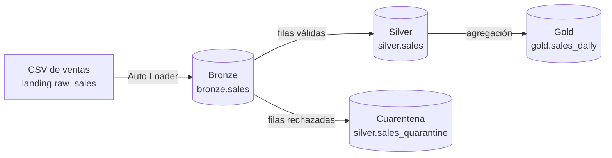

# EcommerceV1: pipeline de ventas e-commerce en Databricks

Pipeline de datos con arquitectura **Medallion** (Bronze, Silver, Gold) que convierte archivos CSV de ventas en una tabla lista para análisis, separando los datos confiables de los dudosos.

## Qué responde

1. ¿Cuáles son las **ventas totales de cada tienda**?
2. ¿Qué **productos se han vendido**, en unidades y en ingreso?

## Arquitectura

| Capa | Tabla | Contenido |
|---|---|---|
| Landing | Volume `workspace.landing.raw_sales` | CSV tal como llegan |
| Bronze | `workspace.bronze.sales` | Copia fiel de los CSV, todo como texto, con archivo de origen y fecha de ingesta |
| Silver | `workspace.silver.sales` | Ventas válidas, con tipos correctos, `total_amount` y `sale_date` |
| Silver | `workspace.silver.sales_quarantine` | Filas rechazadas, con el dato original y el motivo |
| Gold | `workspace.gold.sales_daily` | Ventas por día, tienda y producto |

**Tecnologías:** Databricks (serverless), Unity Catalog, Delta Lake, Auto Loader, Structured Streaming, PySpark y SQL.

## Tabla final: `gold.sales_daily`

Una fila por día, tienda y producto.

| Columna | Descripción |
|---|---|
| `sale_date`, `store_id`, `product_id` | Granularidad |
| `total_revenue` | Ingreso total (dinero vendido) |
| `total_units` | Unidades vendidas |
| `transaction_count` | Número de transacciones |
| `calculated_at` | Momento del cálculo |

Al ser el nivel más fino, se suma hacia arriba para responder cualquier pregunta: por tienda, por producto o por periodo.

## Calidad de datos

Cada fila se valida y se registra el primer motivo que falle. Las filas rechazadas van a `silver.sales_quarantine` con su `quarantine_reason`.

| Caso | Destino | Motivo |
|---|---|---|
| Campo obligatorio vacío (`transaction_id`, `product_id`, `store_id`, `quantity`, `price_per_unit`, `transaction_timestamp`) | Cuarentena | `campo_obligatorio_nulo` |
| Cantidad no numérica | Cuarentena | `cantidad_no_numerica` |
| Precio no numérico | Cuarentena | `precio_no_numerico` |
| Fecha inválida | Cuarentena | `fecha_invalida` |
| Cantidad negativa | Cuarentena | `quantity_negativa` |
| Cantidad cero | Cuarentena | `quantity_cero` |
| Mismo `transaction_id` y mismo contenido | Una copia en Silver, las demás a cuarentena | `duplicado_exacto` |
| Mismo `transaction_id` y contenido distinto | Cuarentena | `transaction_id_conflictivo` |
| `customer_id` vacío | Silver, con `is_anonymous_customer = true` | n/a |

Las filas cuyo error afecta al ingreso o a la agrupación de Gold (día, tienda, producto) van a cuarentena; los campos descriptivos (`customer_id`, `payment_method`) se conservan con un indicador.

## Estructura del repositorio

| Archivo | Función |
|---|---|
| `notebooks/00_setup.sql` | Crea schemas y Volumes |
| `notebooks/00_generate_data.py` | Genera 3 CSV de ejemplo (datos simulados) |
| `notebooks/01_bronze.py` | Ingesta con Auto Loader |
| `notebooks/02_silver.py` | Validación de calidad, cuarentena y carga a Silver |
| `notebooks/03_gold.sql` | Construye Gold y verifica que sus totales cuadren con Silver |
| `notebooks/04_business_queries.sql` | Consultas de negocio sobre Gold |
| `notebooks/99_reset_dev.py` | Reinicia el pipeline (**destructivo, solo desarrollo**) |

## Cómo ejecutarlo

**Requisitos:** workspace de Databricks con Unity Catalog, catálogo `workspace` y cómputo serverless.

1. Importa los notebooks de `notebooks/` en tu workspace (menú **Import**).
2. Conecta cada notebook a Serverless y ejecútalo con **Run all**, en este orden:

| Orden | Notebook | Resultado esperado |
|---|---|---|
| 1 | `00_setup` | Schemas `landing`, `bronze`, `silver` y `gold` |
| 2 | `00_generate_data` | 3 archivos en `landing` |
| 3 | `01_bronze` | 25 filas en Bronze |
| 4 | `02_silver` | Silver 17 filas, cuarentena 8 filas |
| 5 | `03_gold` | 14 filas; totales 427.75 de ingreso, 30 unidades y 17 transacciones |
| 6 | `04_business_queries` | Ingreso por tienda: S01 212.50, S02 179.75, S03 35.50 |

Para reiniciar desde cero, ejecuta `99_reset_dev` y repite desde `01_bronze`. Si `02_silver` se interrumpe a mitad, reinicia antes de volver a ejecutarlo.

## Decisiones clave

- **Bronze sin modificar:** todo se guarda como texto, tal como llegó, y es la base para reconstruir las capas siguientes.
- **Cuarentena con el dato original:** un valor inválido (por ejemplo, un precio `abc`) se conserva tal cual junto con su motivo, en lugar de descartarse o corregirse.
- **Dinero en `DECIMAL`:** evita los errores de redondeo de `float`.
- **Clientes anónimos:** `customer_id` queda NULL con un indicador, sin inventar códigos.
- **Duplicados:** se detectan con un hash del contenido de cada fila, dentro del lote y contra lo ya cargado en Silver.
- **Gold con tres medidas:** ingreso, unidades y transacciones, porque de una suma no se pueden recuperar sus partes.
- **Gold recalculado completo en cada ejecución:** el resultado es siempre el mismo, aunque se ejecute varias veces.
- **Un checkpoint por capa:** permite reconstruir Silver desde Bronze sin volver a leer los archivos.

## Limitaciones

- Si dos versiones del mismo `transaction_id` con contenido distinto llegan en el mismo lote, ambas van a cuarentena; si llegan en lotes distintos, se conserva la primera. Por eso Silver puede dar 17 filas (todo en un lote) o 18 (carga por días).
- Las escrituras a cuarentena y a Silver de cada lote no son atómicas: si la segunda falla, un reintento puede duplicar filas en cuarentena.
- Un archivo corregido con el mismo nombre no se reprocesa; debe llegar con un nombre nuevo.

## Próximos pasos

Orquestación con un Job de Databricks y empaquetado con Databricks Asset Bundles.
