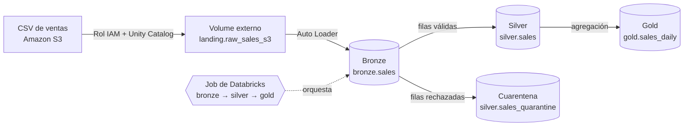

# EcommerceV1: pipeline de ventas e-commerce en Databricks y AWS

Pipeline de datos con arquitectura **Medallion** (Bronze, Silver, Gold) que lee archivos CSV de ventas desde **Amazon S3**, los convierte en una tabla lista para análisis y separa los datos confiables de los dudosos. Se orquesta con un Job de Databricks y se despliega como código con un bundle.

## Qué responde

1. ¿Cuáles son las **ventas totales de cada tienda**?
2. ¿Qué **productos se han vendido**, en unidades y en ingreso?

## Arquitectura



| Capa | Objeto | Contenido |
|---|---|---|
| Landing | Bucket S3, registrado como Volume externo `workspace.landing.raw_sales_s3` | CSV tal como llegan |
| Bronze | `workspace.bronze.sales` | Copia fiel de los CSV, todo como texto, con archivo de origen y fecha de ingesta |
| Silver | `workspace.silver.sales` | Ventas válidas, con tipos correctos, `total_amount` y `sale_date` |
| Silver | `workspace.silver.sales_quarantine` | Filas rechazadas, con el dato original y el motivo |
| Gold | `workspace.gold.sales_daily` | Ventas por día, tienda y producto |

**Tecnologías:** Databricks (serverless), Unity Catalog, Delta Lake, Auto Loader, Structured Streaming, PySpark, SQL, Databricks Jobs, Declarative Automation Bundles, AWS S3 e IAM.

## Acceso seguro a S3

Databricks lee el bucket con un **rol IAM que asume de forma temporal**, sin claves de acceso en los notebooks ni en el repositorio.

| Pieza | Dónde | Función |
|---|---|---|
| Bucket S3 | AWS | Contiene los CSV en `raw_sales/` |
| Rol IAM y política | AWS | Permiso de lectura y escritura sobre el bucket; confía en Unity Catalog con un External ID y en sí mismo |
| Storage credential | Unity Catalog | Referencia el rol |
| External location | Unity Catalog | Registra la ruta `s3://<bucket>` con esa credencial |
| Volume externo | Unity Catalog | Expone `s3://<bucket>/raw_sales` como `/Volumes/workspace/landing/raw_sales_s3` |

## Tabla final: `gold.sales_daily`

Una fila por día, tienda y producto.

| Columna | Descripción |
|---|---|
| `sale_date`, `store_id`, `product_id` | Granularidad |
| `total_revenue` | Ingreso total (dinero vendido) |
| `total_units` | Unidades vendidas |
| `transaction_count` | Número de transacciones |
| `calculated_at` | Momento del cálculo |

Al ser el nivel más fino, se suma hacia arriba para responder cualquier pregunta: por tienda, por producto o por periodo.

## Calidad de datos

Cada fila se valida y se registra el primer motivo que falle. Las filas rechazadas van a `silver.sales_quarantine` con su `quarantine_reason`.

| Caso | Destino | Motivo |
|---|---|---|
| Campo obligatorio vacío (`transaction_id`, `product_id`, `store_id`, `quantity`, `price_per_unit`, `transaction_timestamp`) | Cuarentena | `campo_obligatorio_nulo` |
| Cantidad no numérica | Cuarentena | `cantidad_no_numerica` |
| Precio no numérico | Cuarentena | `precio_no_numerico` |
| Fecha inválida | Cuarentena | `fecha_invalida` |
| Cantidad negativa | Cuarentena | `quantity_negativa` |
| Cantidad cero | Cuarentena | `quantity_cero` |
| Mismo `transaction_id` y mismo contenido | Una copia en Silver, las demás a cuarentena | `duplicado_exacto` |
| Mismo `transaction_id` y contenido distinto | Cuarentena | `transaction_id_conflictivo` |
| `customer_id` vacío | Silver, con `is_anonymous_customer = true` | n/a |

Las filas cuyo error afecta al ingreso o a la agrupación de Gold (día, tienda, producto) van a cuarentena; los campos descriptivos (`customer_id`, `payment_method`) se conservan con un indicador.

## Estructura del repositorio

| Archivo | Función |
|---|---|
| `databricks.yml` | Bundle: define el Job `bronze → silver → gold` |
| `notebooks/00_setup.sql` | Crea schemas y Volumes |
| `notebooks/00_generate_data.py` | Genera 3 CSV de ejemplo (datos simulados) en el Volume externo |
| `notebooks/01_bronze.py` | Ingesta con Auto Loader |
| `notebooks/02_silver.py` | Validación de calidad, cuarentena y carga a Silver |
| `notebooks/03_gold.sql` | Construye Gold y verifica que sus totales cuadren con Silver |
| `notebooks/04_business_queries.sql` | Consultas de negocio sobre Gold |
| `notebooks/99_reset_dev.py` | Reinicia el pipeline (**destructivo, solo desarrollo**) |

## Cómo ejecutarlo

**Requisitos:** cuenta de AWS, workspace de Databricks con Unity Catalog y cómputo serverless, y la CLI de Databricks (0.205 o superior) para el despliegue con bundle.

### 1. Preparar S3 y Unity Catalog

1. Crea un bucket S3 con acceso público bloqueado, **en la misma región que el workspace**, y la carpeta `raw_sales/`.
2. Crea una política IAM de acceso al bucket y un rol IAM; registra el rol en Databricks como *storage credential* y ajusta su política de confianza con el External ID generado (con el rol también como principal de confianza).
3. Crea la *external location* sobre `s3://<bucket>`.
4. Ejecuta `notebooks/00_setup.sql` y después crea el Volume externo:

```sql
CREATE EXTERNAL VOLUME IF NOT EXISTS workspace.landing.raw_sales_s3
LOCATION 's3://<bucket>/raw_sales';
```

### 2. Ejecutar los notebooks (opción manual)

Importa los notebooks y ejecútalos con **Run all** en este orden:

| Orden | Notebook | Resultado esperado |
|---|---|---|
| 1 | `00_generate_data` | 3 archivos en S3 |
| 2 | `01_bronze` | 25 filas en Bronze |
| 3 | `02_silver` | Silver 17 filas, cuarentena 8 filas |
| 4 | `03_gold` | 14 filas; totales 427.75 de ingreso, 30 unidades y 17 transacciones |
| 5 | `04_business_queries` | Ingreso por tienda: S01 212.50, S02 179.75, S03 35.50 |

### 3. Ejecutar con el bundle (opción como código)

```bash
databricks auth login --host <url-del-workspace>
databricks bundle validate -p <perfil>
databricks bundle deploy -p <perfil>
databricks bundle run ecommercev1_medallion -p <perfil>
```

El target `dev` usa `mode: development`: el Job se crea con el prefijo `[dev usuario]` y sus schedules quedan pausados. Los CSV deben existir antes (`00_generate_data`).

Para reiniciar desde cero, ejecuta `99_reset_dev` y repite desde `01_bronze`. Si `02_silver` se interrumpe, limpia solo Silver (sus dos tablas y su checkpoint) antes de volver a ejecutarlo.

## Decisiones clave

- **Bronze sin modificar:** todo se guarda como texto, tal como llegó, y es la base para reconstruir las capas siguientes.
- **Cuarentena con el dato original:** un valor inválido (por ejemplo, un precio `abc`) se conserva tal cual junto con su motivo, en lugar de descartarse o corregirse.
- **Dinero en `DECIMAL`:** evita los errores de redondeo de `float`.
- **Clientes anónimos:** `customer_id` queda NULL con un indicador, sin inventar códigos.
- **Duplicados:** se detectan con un hash del contenido de cada fila, dentro del lote y contra lo ya cargado en Silver.
- **Gold con tres medidas:** ingreso, unidades y transacciones, porque de una suma no se pueden recuperar sus partes.
- **Gold recalculado completo en cada ejecución:** el resultado es siempre el mismo, aunque se ejecute varias veces.
- **Un checkpoint por capa:** permite reconstruir Silver desde Bronze sin volver a leer los archivos.
- **Rol IAM en lugar de claves de acceso:** credenciales temporales, sin secretos en el código y con control y auditoría centralizados.
- **Job con dependencias:** Silver no arranca si Bronze falla, y Gold no arranca si Silver falla; Gold nunca se calcula sobre datos a medias.
- **Ejecución manual:** el Job no tiene schedule ni triggers, para controlar el consumo de cómputo.

## Limitaciones

- Si dos versiones del mismo `transaction_id` con contenido distinto llegan en el mismo lote, ambas van a cuarentena; si llegan en lotes distintos, se conserva la primera. Por eso Silver puede dar 17 filas (todo en un lote) o 18 (carga por días).
- Las escrituras a cuarentena y a Silver de cada lote no son atómicas: si la segunda falla, un reintento puede duplicar filas en cuarentena.
- Un archivo corregido con el mismo nombre no se reprocesa; debe llegar con un nombre nuevo.
- Auto Loader detecta archivos listando el directorio (sin *file events*), suficiente para este volumen.
- El bucket de la demostración está en una región distinta a la del workspace; funciona, pero lo recomendable es usar la misma región.
- Las sesiones serverless pueden terminar con `INTERNAL_ERROR` durante el stream de Silver; se resuelve con una sesión nueva y una limpieza previa de Silver.

## Próximos pasos

- Habilitar *file events* (SNS y SQS) para ingesta incremental sin listar el bucket.
- Despliegue automático con CI/CD desde GitHub.
- Definir la infraestructura de AWS como código (por ejemplo, con Terraform).
- Entorno de producción con su propio target en el bundle.
